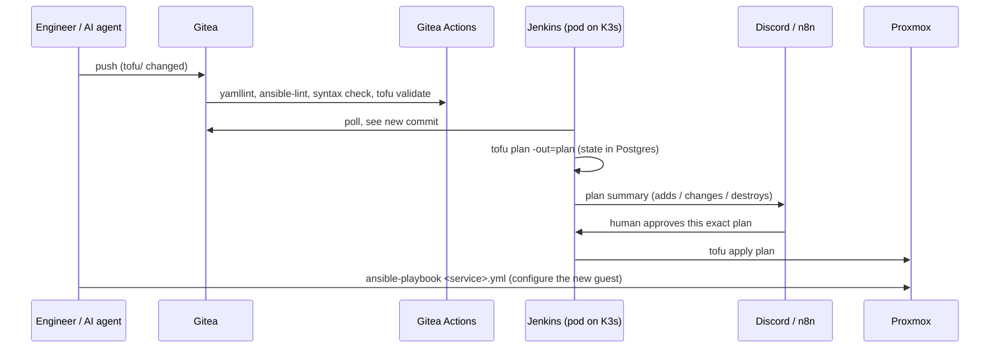

# Architecture

## Hardware

| Host | Role |
|---|---|
| **pve1** | Primary Proxmox hypervisor. Most service LXCs, two GPUs (transcoding and local LLM inference), the TrueNAS VM. |
| **pve2** | Secondary Proxmox hypervisor and Proxmox Backup Server. Holds the other half of every HA pair. |
| **nas** | TrueNAS VM (on pve1), with ZFS pools shared over NFS for media, backups, templates and K3s volumes. |
| 4 × Raspberry Pi | Extra arm64 K3s workers. One is also the Proxmox cluster's quorum device. |
| **workstation** | My workstation (Arch-based), also Ansible-managed |
| **devbox** | Management VM: runs Ansible, OpenTofu and the AI coding agents, and holds the automation key |

pve1 and pve2 form a two-node Proxmox cluster with a Pi as the third
quorum vote. Every guest is an LXC unless it needs a full kernel
(FreeIPA, the game-server VM, Windows).

## Network

| VLAN | Subnet | What lives there |
|---|---|---|
| 1 (default) | 10.20.1.0/24 | Hypervisors, workstations, Home Assistant |
| 10 | 10.20.10.0/24 | Management: backup server |
| 20 | 10.20.20.0/24 | Game servers |
| 30 | 10.20.30.0/24 | Services: almost every LXC, the K3s cluster |
| 40 | 10.20.40.0/24 | Storage and media: TrueNAS, the media stack |
| 4 / 2 | — | IoT and work devices, firewalled into their own zones |

- **DNS:** three AdGuard Home instances share a keepalived virtual IP
  (`10.20.1.10`). If the primary stops answering, a backup takes over the
  VIP within seconds. A health-check script makes the VRRP priority follow
  real DNS answers, not just whether the process is up.
- **Ingress:** Traefik (and Nginx Proxy Manager for older services)
  terminates TLS with a Let's Encrypt wildcard via Cloudflare DNS-01.
  Internal-only names use certificates from step-ca instead.
- **Remote access:** a Headscale (self-hosted Tailscale) mesh. Only a few
  services (game servers, Plex) are port-forwarded.

## How a change gets to production

- **Provisioning (OpenTofu):** every LXC and VM comes from one of two
  modules, [`proxmox_lxc`](../tofu/modules/proxmox_lxc/main.tf) and
  [`proxmox_vm`](../tofu/modules/proxmox_vm/main.tf). They set
  conventions: unprivileged by default, tags, startup order by tier, and
  `lifecycle.ignore_changes` on fields that would otherwise force a
  needless rebuild (see [postmortem 01](postmortems/01-tofu-blind-apply.md)).
  State lives in a dedicated PostgreSQL instance with locking.
- **The approval gate ([`Jenkinsfile`](../Jenkinsfile)):** each run happens
  in a throwaway pod. A push gets a plan. A nightly run reports drift.
  Applies need `TARGET`, either a module list or an explicit `ALL`, and a
  human approval of the saved plan.
- **Configuration (Ansible):** one playbook per service. Each starts with
  the same baseline roles: `common` (packages, users, SSH hardening,
  timezone, unattended upgrades and pending-update metrics),
  `node_exporter` and `alloy`.

## Secrets

All secrets live in **OpenBao** (the open-source Vault fork).

- Each service has its own **AppRole**, whose policy can read only that
  service's KV path. A playbook logs in with its role and reads its
  secrets at run time through `community.hashi_vault.vault_kv2_get`.
- [`scripts/openbao_setup_policies.py`](../scripts/openbao_setup_policies.py)
  creates the policies and AppRoles from a single table, so adding a
  service means adding one line.
- OpenTofu reads its Proxmox token through a read-only `tofu-kv` AppRole.
  It uses a scoped `tofu-agent@pve` API user, falling back to root only
  for the few operations Proxmox reserves for root.
- OpenBao auto-unseals through a second, small OpenBao instance (transit
  seal), so a reboot doesn't need a person to unseal it.

The repo used to have an `ansible-vault` file. It was retired after
[postmortem 03](postmortems/03-stale-checkout-broke-openbao.md): a second
copy of it went stale and silently broke a deploy.

## Observability

| Signal | Path |
|---|---|
| Metrics | `node_exporter` on every host, plus exporters for Proxmox, TrueNAS, SNMP and blackbox probes → Prometheus |
| Logs | Alloy on every host → Loki (journald, Docker) |
| Dashboards | Grafana, with SSO through Authentik |
| Alerts | Alertmanager → ntfy (phone push), Home Assistant and Discord |
| Uptime | Uptime Kuma for user-facing checks |

Hosts discover themselves: Prometheus targets are generated from the
Nautobot source of truth
([`scripts/nautobot_prometheus_sd.py`](../scripts/nautobot_prometheus_sd.py)).

## Drift and hygiene

- **OpenTofu drift:** Jenkins runs a full plan nightly and posts only if
  something changed.
- **Docs vs. reality:** [`scripts/drift_check.py`](../scripts/drift_check.py)
  runs weekly. It compares the documented guests (VMID, node, IP) with what
  Proxmox reports, and the documented reverse-proxy hosts with the proxy's
  live config. It also flags any guest with no backup job.
- **Vulnerabilities:** a weekly Trivy sweep of every running container
  image (`.gitea/workflows/trivy-scan.yml`).
- **Stale references:**
  [`scripts/check_stale_ip_refs.py`](../scripts/check_stale_ip_refs.py)
  checks firewall port-forwards, DNS rewrites and proxy hosts for rules
  that still point at a retired IP. It was written after a port-forward
  kept pointing at a moved service for four days.

## Kubernetes

See [k3s.md](k3s.md).
